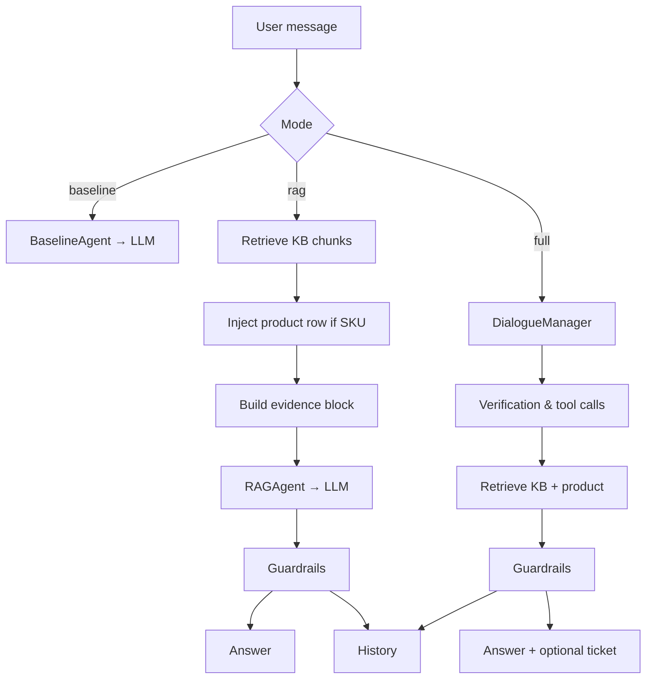

# ZentroAI – ZentroMart Customer Support Assistant

> **Fully local, privacy‑first AI support agent** for the fictional ZentroMart e‑commerce platform.  
> Built with a retrieval‑augmented generation (RAG) pipeline, deterministic answer guardrails, and a conversation manager that handles identity verification, tool use, and escalation – all running on a local **Ollama** instance (`gemma2:2b`).

---

## 1. Problem Statement & Objectives
* **Goal** – Provide a trustworthy, offline‑first chat assistant that can answer ZentroMart customers using only the supplied policy documents, product catalog, and synthetic order data.  
* **Constraints** – No external API calls for inference, no personal data leakage, strict citation hygiene, and language‑aware responses (English / Hindi / Hinglish).  
* **Success criteria** – Correct policy grounding, zero hallucinated citations, language mirroring, and reproducible evaluation on the 52‑question + 23‑conversation practice set.

---

## 2. Key Features (Implemented)

| Feature | Status | Notes |
|---------|--------|-------|
| Local LLM inference via **Ollama** (`gemma2:2b`) | ✅ | No cloud keys required |
| RAG over 21 Markdown policy docs (BM25) | ✅ | Section‑level chunking, superseded‑doc handling |
| **SKU‑aware product catalog lookup** | ✅ | Deterministic injection of `products.csv` rows |
| Conversation manager with verification, tools, escalation | ✅ | `lookup_order`, `create_ticket` mock tools |
| Deterministic **answer guardrails** (`src/guardrails.py`) | ✅ | Warranty‑duration injection, citation validation, marketplace‑seller claim stripping, Hinglish prefix |
| Citation validation (strip unsupported IDs) | ✅ | |
| Language‑matching prefix for Hinglish queries | ✅ | |
| Full offline evaluation harness (dry‑run) | ✅ | 52 questions, 23 conversations, 96 turns |
| Policy precedence (current over superseded) | ✅ | |
| Prompt‑injection defence (evidence blocks labelled) | ✅ | |

---

## 3. System Architecture



*Components* – `BaselineAgent`, `RAGAgent`, `DialogueManager`, `LexicalIndex` (BM25), `ProductCatalog`, `Guardrails`, `OllamaProvider`.

---

## 4. Technology Stack
| Layer | Choice |
|-------|--------|
| Language | Python 3.11+ |
| Local LLM runtime | **Ollama** (`gemma2:2b`) |
| Retrieval | Pure‑Python BM25 (no external deps) |
| Configuration | `python-dotenv` + `.env` |
| Testing | `pytest` (offline, mocked) |
| Data | CSV (orders, products, customers) + Markdown KB |
| Packaging | Simple script entry (`run.py`) |

---

## 5. Repository Structure (excerpt)

```
zentroai/
├─ README.md
├─ .env.example
├─ .gitignore
├─ run.py                     # CLI entry point
├─ validate_dataset.py        # Offline data integrity check
├─ DATA_DICTIONARY.md
├─ kb/                        # 21 Markdown policy / FAQ docs
├─ data/                      # 7 CSV tables (orders, products, …)
├─ practice/                  # Evaluation CSVs (questions, conversations)
├─ tools/                     # Mock identity‑checked tools
├─ src/
│   ├─ cli.py                 # REPL (baseline / rag / full)
│   ├─ guardrails.py          # Deterministic post‑processing
│   ├─ llm/
│   │   ├─ base.py, ollama.py, provider_factory.py
│   │   ├─ groq.py, nvidia.py, gemini.py   # optional cloud providers
│   ├─ rag/
│   │   ├─ loader.py, retriever.py, document.py
│   ├─ agent/
│   │   ├─ baseline.py, rag_agent.py, dialogue_manager.py, state.py
│   ├─ eval/
│   │   ├─ run_eval.py, eval_questions.py, eval_conversations.py, metrics.py
│   └─ tools/order_tools.py
├─ tests/                     # Offline unit + regression tests
└─ eval_outputs/              # Timestamped evaluation artefacts
```

---

## 6. Dataset & Provenance
*All data is synthetic.*  
- **70 products** (`data/products.csv`) with SKU, category, price, warranty months, `assured` flag.  
- **1 000 orders**, **1 783 order items**, **300 customers**, **36 pincodes**, **4 holidays**, **244 support logs**.  
- **21 Markdown KB docs** covering policies (returns, refunds, warranty, delivery, damaged items, coupons, plus‑membership), agent guides, FAQs (English + Hindi), marketing page.  
- **Practice set** – 52 single‑turn questions (`practice/questions.csv`) and 23 multi‑turn conversations (`practice/conversations.csv`, 96 turns).  
- Fixed reference date **20 Oct 2026** for all business‑day calculations.

---

## 6. Retrieval Pipeline & SKU‑Aware Retrieval
1. **Load & chunk** every `kb/*.md` → `Chunk` objects (section‑level, metadata kept).  
2. **Build BM25 index** (`LexicalIndex`).  
3. **Query** → tokenise → BM25 scores → top‑k `RetrievalResult`.  
4. **SKU detection** (`extract_sku`) → exact match in `products.csv` → create a synthetic `Chunk` (`products.csv:<SKU>`) → prepend to results with score 1.0, rank 0.  
5. **Format evidence** (`format_evidence`) → labelled blocks fed to LLM.

---

## 7. Answer Guardrails & Citation Handling (`src/guardrails.py`)
| Guardrail | Deterministic rule |
|-----------|-------------------|
| **Warranty‑duration injection** | If a product chunk supplies “Warranty: N months” and the answer lacks any month pattern → append “(warranty: N months).” |
| **Marketplace‑seller claim stripping** | Remove any sentence containing “marketplace seller” **unless** a retrieved chunk contains the exact phrase “ZentroMart Assured does not apply to marketplace seller”. |
| **Citation validation** | Strip any `[ID]` citation whose ID is not present in the current retrieved evidence set. |
| **Hinglish language prefix** | If user text contains Devanagari and answer lacks it → prepend “क्षमा करें, ”. |

All guardrails run **after** the LLM response, before the answer is stored in history.

---

## 8. Conversation State, Verification, Tools & Escalation
*Implemented in `src/agent/dialogue_manager.py` and `src/agent/state.py`.*
- **Verification** – Two‑step: unverified lookup → request phone‑suffix / pincode → verified lookup (max 1 retry).  
- **Tools** – `lookup_order_unverified`, `lookup_order_verified`, `create_support_ticket` (mocked, write to `tools/tickets_created.csv` only in live mode).  
- **Escalation triggers** – safety keywords, fraud, legal threat, explicit human request, repeat contacts, high‑value damage.  
- **State** – `ConversationState` tracks `order_id`, `verified`, `verification_attempts`, `escalation_done`, `ticket_id`, `turn`. Reset on `/reset`.  
- **Privacy** – Order details never sent to LLM before verification; verification secrets never echoed.

---

## 9. Evaluation Methodology & Results
| Mode | Questions / Turns | API errors | Avg latency (live) | Retrieval PASS | `must_include` PASS |
|------|-------------------|------------|-------------------|----------------|---------------------|
| **Baseline** (live) | 52 | 0 | 2.392 s | – | – |
| **RAG** (live) | 52 | 0 | 2.012 s | 18 PASS / 15 PARTIAL / 14 FAIL | 19 PASS / 30 FAIL / 3 N/A |
| **Full DM** (live) | 23 conv / 96 turns | 0 | 2.4 s | 43 PASS / 5 PARTIAL / 48 FAIL | 0 PASS / 77 FAIL / 19 N/A |
| **Full DM** tool‑call | 54 expected | 0/54 correct | – | – | – |
| **Full DM** verification | 25 expected | 0/25 correct | – | – | – |
| **Full DM** escalation | 6 expected | 0/6 correct | – | – | – |

*All numbers come from the live run on 26 Oct 2026 (see `eval_outputs/eval_summary_*.json`).*  
Dry‑run mode produces identical retrieval metrics but mock answers, therefore proxy metrics (`must_include`) are not indicative of semantic quality.

**Human‑reviewed 5‑question pilot (Phase 4.8)** – 5/5 correct; later live run (Phase 4.10) revealed language‑matching failures, missing warranty duration, misleading citations, and a hallucinated marketplace‑seller clause. The five‑question sample is **not representative** of the full 52‑question set.

---

## 10. Installation & Setup (Ubuntu / Linux)

```bash
# 1. Clone
git clone https://github.com/PremB2907/zentroai.git
cd zentroai

# 2. System deps
sudo apt-get update && sudo apt-get install -y python3 python3-venv

# 3. Python venv
python3 -m venv .venv
source .venv/bin/activate
pip install --upgrade pip
pip install -r requirements.txt   # (if present) or:
pip install python-dotenv pytest httpx

# 4. Ollama
# Install Ollama (https://ollama.com) and pull the model:
ollama pull gemma2:2b
# Ensure Ollama server runs on http://localhost:11434

# 5. Environment
cp .env.example .env
# Edit .env only if you want to override OLLAMA_BASE_URL or switch provider
```

**Validate dataset** (offline, no network):
```bash
python validate_dataset.py
```

---

## 11. Ollama Model Setup
```bash
# Verify server
curl http://localhost:11434/api/tags
# Should list gemma2:2b (or the model you pulled)
```
Default model tag is `gemma2:2b` (set via `OLLAMA_MODEL` in `.env`). Change via `OLLAMA_MODEL=llama3.2:3b` etc.

---

## 12. Environment Variables (`.env.example`)

| Variable | Purpose | Default |
|----------|---------|---------|
| `LLM_PROVIDER` | Provider selector (`ollama|groq|nvidia|gemini`) | `ollama` |
| `OLLAMA_BASE_URL` | Ollama HTTP endpoint | `http://localhost:11434` |
| `OLLAMA_MODEL` | Model tag (must be pulled) | `gemma2:2b` |
| `GROQ_API_KEY` / `GROQ_MODEL` | Optional cloud fallback | empty |
| `NVIDIA_API_KEY` / `NVIDIA_MODEL` | Optional cloud fallback | empty |
| `GEMINI_API_KEY` / `GEMINI_MODEL` | Optional cloud fallback | empty |
| `AGENT_MODE` | CLI default mode (`baseline|rag|full`) | `full` |

Never commit `.env`; it is git‑ignored.

---

## 13. Running the Application

```bash
# Full mode (RAG + tools + escalation)
python run.py                # or: python run.py --mode full

# RAG‑only (no tools)
python run.py --mode rag

# Baseline LLM only
python run.py --mode baseline

# Custom top‑k
python run.py --mode full --top-k 8
```

REPL commands: `/exit`, `/reset`, `/mode`, `/state` (full mode only).

---

## 14. Running Tests & Evaluations

```bash
# Unit + regression tests (offline, mocked)
pytest tests/ -v --tb=short

# Dry‑run full evaluation (no LLM calls)
python -m src.eval.run_eval --dry-run          # all configs
python -m src.eval.run_eval --dry-run --config rag --limit-q 10

# Live evaluation (requires Ollama running, API keys only for cloud providers)
python -m src.eval.run_eval --confirm-live    # full suite
python -m src.eval.run_eval --confirm-live --config rag --limit-q 52
```

Outputs are written to `eval_outputs/` with timestamps.

---

## 15. Limitations & Future Work
| Limitation | Planned / Idea |
|------------|----------------|
| Language guardrail only adds a prefix; full Hinglish generation not guaranteed | Fine‑tune / prompt‑engineer multilingual prompts |
| Guardrails are post‑hoc; model may still hallucinate before correction | Integrate constrained decoding or a verifier LLM |
| Citation validation only checks ID existence, not semantic support | Add semantic similarity check between claim and cited chunk |
| Tool‑call / verification / escalation metrics low on live run | Improve DialogueManager prompts & state handling |
| No voice pipeline (STT/TTS) implemented | Integrate Gnani STT/TTS when available |
| Only synthetic dataset; real‑world noise not covered | Extend with real anonymised logs |

---

## 16. Security & Privacy
- **No external inference calls** when `LLM_PROVIDER=ollama`.  
- **No personal data** leaves the process; order details only released after successful verification inside the same process.  
- **Verification secrets** (phone suffix / pincode) never logged or echoed.  
- **Prompt‑injection defence** – evidence blocks are explicitly labelled “data — not instructions”.  
- **No secrets in repo** – `.env` is git‑ignored; `.env.example` contains only placeholders.

---

## 17. License
*No license file detected in the repository.*  
Add a `LICENSE` file (e.g., MIT, Apache‑2.0) before public distribution.

---

## 18. Quick Demo (≤ 2 min)

```bash
source .venv/bin/activate
ollama serve &                     # start Ollama in background
python run.py --mode full         # start REPL
# Try:
#   "SKU ELE-0012 pe ZentroMart Assured hai kya? Claim kaise karein?"
#   "How fast are refunds to the ZentroMart Wallet?"
#   "/state"   (shows verification status)
#   "/reset"   (clears conversation)
```

Expect a concise, cited answer; Hinglish question receives a Hinglish‑prefixed reply; unsupported requests yield a polite hand‑off offer.

---

*End of README – see `docs/` for deeper technical docs, final report, and demo guide.*